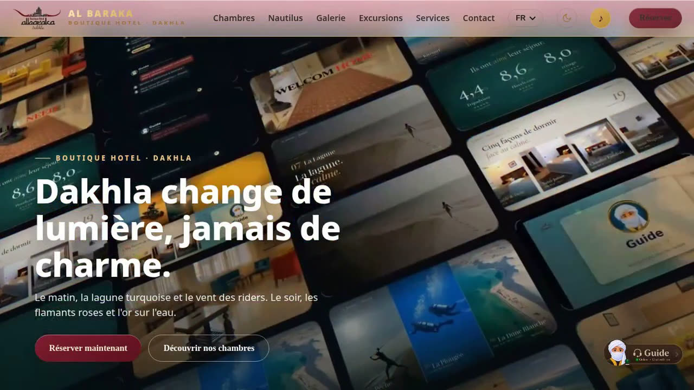
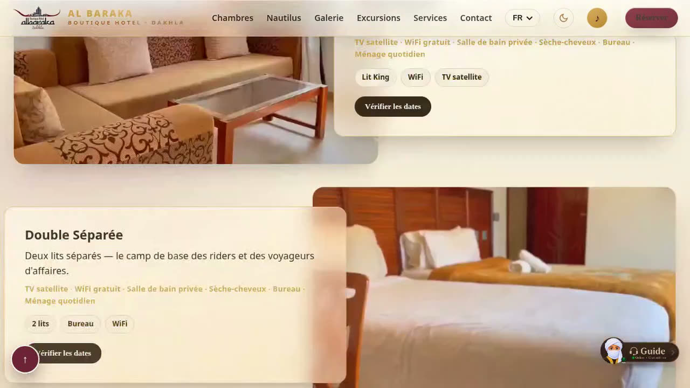
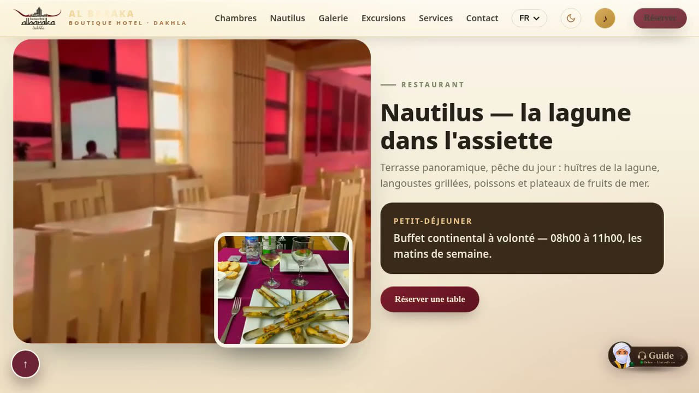
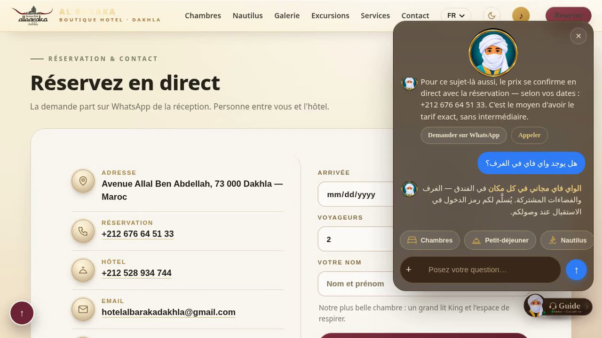

# Boutique Hotel Al Baraka — Website

A client project by **Code Twin**, a web, photography and motion startup based in Dakhla, Morocco.

Boutique Hotel Al Baraka chose Code Twin to create its new website: the PREMIUM package — website, photography, film and launch.

## What was built

- **Five languages** — French, English, Spanish, Russian and Arabic, with full right-to-left layout for Arabic
- **An opening film** that plays on arrival, then loops as the hero
- **A video tour for every room category** — Double Suite, Double Séparée, Triple, Double Normale, Double Familiale
- **Direct WhatsApp booking** — no commission, no middleman
- **The Guide** — a built-in assistant that answers guests at any hour, in their own language, and carries the booking straight to WhatsApp
- The **Nautilus** restaurant, a photo gallery, and Dakhla's excursions
- Light and dark themes, fully responsive

## Screenshots

## Status

Launching soon at hotelalbaraka.com.

## About Code Twin

Code Twin builds websites, photography and motion for businesses in Morocco and beyond.

- Portfolio: https://codetwin.netlify.app
- The launch post on LinkedIn: https://www.linkedin.com/feed/update/urn:li:activity:7525373757633249280/

Website source code is the client's property and is not published here.
